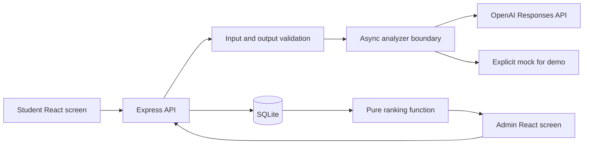

# CampusTriage — Software Requirements Specification

Version 1.0 · 24 November 2026 · Solo Software Engineering submission, 25 November 2026

## 1. Purpose and scope

CampusTriage captures campus maintenance reports in students' own words and presents an explainable pending queue to an admin. The core problem is that arrival order alone does not identify a later report describing a possible safety concern. The prototype combines structured AI extraction with deterministic prioritisation and human review. It does not establish an actual hazard or promise an emergency response.

Implemented scope: two React screens; Express JSON API; SQLite storage; server-side OpenAI adapter; explicit mock demo; email-entry student sessions; complaint resolution; deterministic ranking; error and manual-review behaviour; local verification and fictional simulations. Live OpenAI usage is not yet verified because credentials and model are missing. There is no claim of measured reduction in response time or improved real-world accuracy.

## 2. Actors and use cases

| Actor | Implemented use cases |
| --- | --- |
| Student | Enter a college email to sign in; submit description/location, see saved confirmation or error, and log out |
| Admin | Load ranked pending complaints, inspect original text and analysis/evidence/source/review status, read rank reason, resolve a ticket and refresh the queue |
| Analyzer adapter | Extract category, concise summary, possible safety concern, quoted evidence and review flag; reject/timeout on failure |
| Developer/presenter | Run explicit mock simulation, seed fictional data, run fixed-clock FIFO comparison and acceptance checks |

Student complaint submission requires a signed session established by entering a valid `@iiitl.ac.in` address. This version does not verify email ownership and sends no email; anyone who knows a student's college email can sign in as them. Login attempts are limited to 10 per IP per minute. The admin screen and resolution routes remain unauthenticated and are for local demonstration only.

## 3. Functional requirements and acceptance mapping

| ID | Requirement | Implemented acceptance evidence |
| --- | --- | --- |
| FR-01 | Accept a nonblank description up to 5000 characters and location up to 200; reject invalid input | `api.test.js`: input validation, invalid JSON and body size tests |
| FR-02 | Preserve original strings, UTC creation timestamp, pending status and validated analysis in SQLite; return HTTP 201 | `api.test.js`: creation and reopen persistence tests; browser submission |
| FR-03 | Invoke an async replaceable analyzer, preserving its five agreed fields | `analyzer.test.js`: structured provider request and result; `src/analyzer.js` |
| FR-04 | Validate types and nonblank summary/category; require exact original-text evidence when supplied and evidence for a safety flag | `analyzer.test.js`: evidence/invalid output tests; API injected-evidence fallback test |
| FR-05 | On missing AI settings, timeout, HTTP failure, refusal or malformed output, preserve a valid complaint with null analysis and required review | Analyzer rejection/deadline tests, HTTP timeout test, browser timeout scenario |
| FR-06 | Return only pending tickets in backend-ranked order with a readable reason and score metadata | Ranking tests and browser queue assertions |
| FR-07 | Prioritise possible safety concerns, then routine waiting >=48 hours, then routine weighted score with oldest-first ties | `ranking.test.js`; `simulation.test.js`; browser boundary promotion |
| FR-08 | Persist resolution, remove resolved tickets from pending list, preserve first resolution time on retries, return 404 for unknown IDs | `api.test.js`: resolution/idempotence/404; browser resolve |
| FR-09 | Show loading, empty, error and success states; refresh queue after resolution; keep ordering in backend | React implementation; browser empty/error/submit/resolve checks |
| FR-10 | Identify active analysis mode and persisted source per complaint; never silently use mock as a live fallback | Mode/configuration tests; status endpoint; screenshots with simulation banner |
| FR-11 | Provide reproducible fixtures and a fixed-time comparison against FIFO, clearly labelled as simulation | `simulate.js`, `simulation-results.json`, browser before/after screenshots |
| FR-12 | Preserve milestone SQLite records when adding analysis provenance | `api.test.js`: legacy database migration test |
| FR-13 | Accept valid college-email entry, normalize it, start a student session, and limit login attempts | `auth.test.js`; browser login-to-submit check |
| FR-14 | Keep student email out of analyzer input and admin queue responses | `auth.test.js`: analyzer input and queue privacy assertions |
| FR-15 | Preserve existing student sessions and complaint student IDs while removing obsolete OTP storage | `api.test.js` and `auth.test.js`: migration coverage |

## 4. Nonfunctional requirements and limits

| ID | Requirement | Implementation / verification |
| --- | --- | --- |
| NFR-01 | Bound AI request duration | Default 15 seconds, configurable integer 1–60000 ms; deadline includes response-body reading; stalled fetch/body tests |
| NFR-02 | Keep secrets server-side and out of source control | Environment configuration only, names-only `.env.example`, ignore rules, status exposes setting names rather than values |
| NFR-03 | Avoid interpreting unsafe input as SQL or HTML | SQLite bound parameters; React text rendering without raw HTML; 32 KB request limit |
| NFR-04 | Reproduce prioritisation independent of wall clock | Pure function with explicit reference time; no time-changing public API; fixed-clock fixtures/tests |
| NFR-05 | Support classroom laptop and mobile-width screens | Local Chrome desktop and 390px viewport verification; semantic labels, keyboard focus styles and status/alert regions |
| NFR-06 | Maintain a separable AI boundary and independently testable ranking | Dedicated analyzer and ranking modules; injected fetch/analyzer/clock in tests |
| NFR-07 | Retain data across normal server restart | File-backed SQLite and reopen test; previous milestone smoke also verified actual server restart |

No throughput, load, availability or accessibility certification is claimed. SQLite uses synchronous calls suitable for this small demonstration, not a proven high-concurrency workload. The OpenAI output contract is tested with stubs; provider compatibility and real-language extraction remain externally unverified.

## 5. Architecture



Production-build local mode: Express serves `client/dist` and the APIs from one loopback origin. Development: Vite proxies `/complaints` and `/api` to Express on port 3001. React uses hash navigation (`#student`, `#admin`). No frontend sorting or analysis logic determines queue order.

Main modules: `server/src/app.js` (routes), `database.js` (schema, migration, mapping), `analyzer.js` (provider/mock validation), `ranking.js` (pure policy), `index.js` (configuration/startup). `client/src/main.jsx` supplies the student and admin views. Test-only adapters and clocks use dependency injection. Provider deadlines and failures are handled before database insertion so valid reports survive analysis failure.

## 6. Persistent data model

One `complaints` table contains:

| Field | Purpose |
| --- | --- |
| `id` | SQLite autoincrement integer primary key |
| `description`, `location` | Original validated student strings |
| `analysis` | JSON containing the five agreed fields, or SQL NULL after analysis failure |
| `analysis_status` | `succeeded` or `failed`, distinct from complaint resolution status |
| `analysis_mode` | `openai`, `mock`, historical `legacy-mock`, or a test injection label |
| `created_at`, `resolved_at` | UTC ISO timestamps; resolved time nullable until resolution |
| `status` | `pending` or `resolved` |
| `severity`, `urgency`, `impact` | Explicit REAL factors constrained to 0–10 |
| `scoring_source` | `provisional-defaults` for new requests, `demo-fixture` for intentional synthetic factors |

Waiting, numeric score, tier, rank reason and review status are derived on response. Review is required if analysis failed, analysis requests review, or a possible safety concern was flagged. Resolution preserves this review evidence; there is no state representing completed AI review.

Migration adds `analysis_mode` to pre-existing milestone databases and labels their historical analysis `legacy-mock`. It does not drop tables or remove complaints.

## 7. Interfaces

- `POST /complaints`: JSON `{description, location}`; 201 full saved object including ranking and source; 400 invalid input/JSON; 413 oversized body. Analysis failure still returns 201 if storage succeeds.
- `GET /complaints`: 200 ranked array of pending full complaint objects, or `[]`.
- `PATCH /complaints/:id/resolve`: 200 full resolved complaint, idempotent resolution timestamp; 404 unknown/invalid ID.
- `GET /api/status`: active analyzer mode, configuration readiness, missing setting names, configured model, current-session live verification flag, simulation flag and UTC reference time. Never returns the key.
- Unknown routes: 404 JSON error. Unexpected server/storage errors: generic 500 JSON error. A storage failure cannot promise persistence.

Full example responses and exact commands appear in the README. `analyzeComplaint(description)` returns nonblank string `category`, nonblank string `summary`, boolean `possibleSafetyRisk`, string-or-null `riskEvidence`, and boolean `needsReview`. Provider requests use a strict JSON schema and treat the complaint as untrusted data. Output validation independently checks evidence with exact, case-sensitive substring matching. Grounded quotes support inspection but do not establish that the model's safety interpretation is correct.

## 8. Ranking specification

Only pending complaints enter the API queue. Compute elapsed hours from the provided reference UTC instant, clamped at zero. Waiting is `min(10, elapsedHours / 6)`. All other factors are explicit 0–10 inputs.

`score = 0.4 * severity + 0.3 * urgency + 0.2 * impact + 0.1 * waiting`

Tier 1: validated `possibleSafetyRisk === true`, oldest first. Tier 2: remaining tickets with elapsed hours **>=48**, oldest first regardless of score. Tier 3: remaining routine tickets, descending numeric score, then oldest first. Equal timestamp ties use ascending ID. No rounding affects sorting.

New submissions always use provisional severity=5, urgency=5 and impact=5 because neither analyzer supplies calibrated numeric factors. Score starts at 4.5 and waiting contributes at most 1 point. Thus new routine tickets with equal defaults effectively follow age. The API/UI explicitly disclose these defaults. Synthetic fixture inputs intentionally differ to make weighted scoring demonstrable. Safety and overdue rules override the score. Failed analysis has unknown risk and uses the remaining age/score tiers while showing manual review required.

## 9. Failure and state transitions

```text
Valid submission -> analyze -> validate -> persist pending -> 201
                       |          |
                       +-- failure+--> persist pending, analysis=null, review required -> 201
Pending -> resolve -> resolved (excluded from queue)
Resolved -> resolve -> same resolved state and original resolution time
Invalid input -> 400/413 without analysis or insertion
Unauthenticated complaint submission -> 401
Storage failure -> 500 (no guaranteed saved complaint)
```

The login endpoint limits each IP to 10 attempts per minute. Student sessions use a signed, HttpOnly, SameSite=Lax cookie. Email entry is not proof of identity or ownership; impersonation is possible when someone knows another student's address. The UI preserves form values after request failure and displays an actionable error. A timeout may leave uncertainty about whether a request saved; the UI advises checking the admin queue before retrying. Refresh failure leaves the old queue visibly marked as potentially stale. There is no request-id based deduplication or optimistic update that assumes successful resolution.

## 10. Evaluation and acceptance results

Baseline confirmed: 13/13 backend tests before the earlier milestone changes. After switching to email-entry-only student login, **29 backend tests passed, 0 failed**; the production React build passed; and real Chrome exercised the built frontend with local APIs and SQLite in **13 passing browser checks**, including logout and rejection of a post-logout complaint. Browser verification uses mock analysis and in-memory test databases. Evidence: `backend-test-results.txt`, `browser-results.json` and `screenshots/` in this directory. Automated adapter tests use stubs, not real model calls.

Fictional fixed-clock simulation uses the same three pending reports under each policy. FIFO stays `[1,2,3]`; just before the oldest routine report reaches 48 hours, ranking is `[3,2,1]`; at exactly 48 hours, ranking is `[3,1,2]`. The hazard remains first and the older routine report moves from position 3 to 2. Factors, timestamps and evidence are recorded in `simulation-results.json`. This is a policy demonstration, not a field study or an AI benchmark.

Final submission verification also opened and rendered `CampusTriage.pptx` as exactly five slides in Keynote 13.1, preserving the native comparison table and fictional screenshot. This is application-render verification of the PowerPoint file, not a real AI accuracy check.

Remaining acceptance item: set `OPENAI_API_KEY` and `OPENAI_MODEL`, then obtain a successful `npm run verify:live` result. Without that success, live integration remains unverified. A real UI session under OpenAI mode also needs rehearsal because model output may vary.

## 11. Software Engineering decisions and future work

Requirements traceability ties user behaviours to API/ranking/browser acceptance checks. Modular boundaries isolate probabilistic extraction from deterministic policy and persistence. Dependency injection permits controlled failures and exact-time tests. Persistent provenance and explicit fallback improve inspectability. Git records the earlier backend milestone; the submission changes are prepared on `feature/backend-prioritisation` for review.

Chosen tradeoffs: Express and SQLite keep installation and demonstration small; React separates student/admin views while reusing the JSON API. The LLM handles language variation while deterministic rules make queue policy testable. A rules-only mock remains available for reproducibility; it does not validate the real model.

Future work: verify student email ownership before treating the address as identity; authenticate admins and authorize resolution; protect remaining public endpoints; evaluate multilingual safety extraction with labelled data; calibrate factors with campus stakeholders; support completed manual reviews and audit history; add request deduplication, backups, notifications and operational monitoring.
